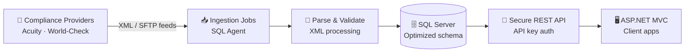

<!-- Header banner -->
<p align="center">
  
</p>

<!-- Typing animation -->
<p align="center">
  <a href="https://github.com/issacharnp">
    
  </a>
</p>

<p align="center">
  
  
  
</p>

---

## 👋 About Me

I'm a Software Engineer with **3+ years** of experience building and maintaining enterprise web applications on the Microsoft stack. I design relational schemas, build secure RESTful APIs, and run large-scale data pipelines that ingest XML and SFTP feeds from compliance data providers such as **Acuity** and **World-Check**.

I work directly with clients to turn requirements into working technical solutions, and I care a lot about performance: I improved one application's speed by **70%** through refactoring and SQL query optimization, without changing a single line of business logic.

```csharp
public class Issachar : SoftwareEngineer
{
    public string Location     => "Nepal 🇳🇵";
    public int    Experience   => 3; // years, and counting
    public string[] Core       => { "C#", "ASP.NET MVC", "Entity Framework", "SQL Server" };
    public string[] Learning   => { ".NET Core", "Docker", "PostgreSQL" };
    public string   Superpower => "Shipping faster with AI agents, without shipping bugs";
}
```

---

## 🤖 Building with AI Agents

I use AI coding agents as part of my daily engineering workflow, to build new features faster and to improve existing systems safely.

- **Build:** scaffold APIs, data models, and integrations with agents, then review and harden the output against coding standards
- **Improve:** use agents to analyze legacy code, suggest refactors, and find slow SQL queries and execution-plan problems
- **Automate:** wire AI into business workflows and data pipelines (classification, data cleaning, reporting)
- **Verify:** every agent-generated change is reviewed, tested, and owned by me before it reaches production

> 💡 This README itself was designed with an AI agent, then reviewed and tuned by hand. Want something like this for your team or product? Let's talk.

---

## 🛠️ Tech Stack

<p align="center">
  
</p>

<p align="center">
  
  
  
  
  
  
  
</p>

<details>
<summary><b>📂 Click to see the full skill breakdown</b></summary>
<br>

| Area | Skills |
|---|---|
| **Languages** | C#, T-SQL, JavaScript, HTML5, CSS |
| **Frameworks** | ASP.NET MVC, .NET Framework, Entity Framework (Code First), jQuery, Bootstrap |
| **Databases** | SQL Server: schema design, stored procedures, SQL Agent jobs, query tuning with execution plans |
| **APIs & Integration** | RESTful API design, API key authentication, third-party API integration, XML processing, SFTP data ingestion |
| **Front End** | Responsive layouts, DOM manipulation, cross-browser debugging |
| **Tools & Practices** | Git, Visual Studio, browser DevTools, Agile/Scrum |
| **AI** | AI coding agents, AI-assisted refactoring and code review, AI integration into business workflows |

</details>

### 🌱 Currently Learning

<p>
  
  &nbsp; <b>.NET Core · Docker · PostgreSQL</b>
</p>

---

## ⚙️ How My Data Pipelines Work



---

## 🏆 Highlights

<details>
<summary><b>⚡ 70% performance improvement</b></summary>
<br>
Refactored a slow enterprise application and tuned its SQL using execution plans, cutting response times by 70% while keeping all business logic unchanged.
</details>

<details>
<summary><b>📊 Large-scale compliance data pipelines</b></summary>
<br>
Built and run pipelines that ingest XML and SFTP feeds from compliance data providers such as Acuity and World-Check into SQL Server, scheduled with SQL Agent jobs.
</details>

<details>
<summary><b>🔐 Secure RESTful APIs</b></summary>
<br>
Designed and built REST APIs with API key authentication and integrated third-party services into enterprise applications.
</details>

<details>
<summary><b>🤝 Client-facing delivery</b></summary>
<br>
Work directly with clients to gather requirements and turn them into technical solutions.
</details>

---

## 📈 GitHub Activity

<p align="center">
  
</p>

<p align="center">
  
  
</p>

<p align="center">
  
</p>

<!-- Snake animation: generated by .github/workflows/snake.yml -->
<p align="center">
  <picture>
    <source media="(prefers-color-scheme: dark)" srcset="https://raw.githubusercontent.com/issacharnp/issacharnp/output/github-snake-dark.svg" />
    <source media="(prefers-color-scheme: light)" srcset="https://raw.githubusercontent.com/issacharnp/issacharnp/output/github-snake.svg" />
    
  </picture>
</p>

---

## 📫 Let's Connect

<p align="center">
  <a href="https://www.linkedin.com/in/YOUR-LINKEDIN/"></a>
  <a href="mailto:YOUR-EMAIL@example.com"></a>
  <a href="https://github.com/issacharnp"></a>
</p>

<p align="center"><i>Open to .NET roles, freelance work, and collaborations on AI-assisted development.</i></p>

<p align="center">
  
</p>
